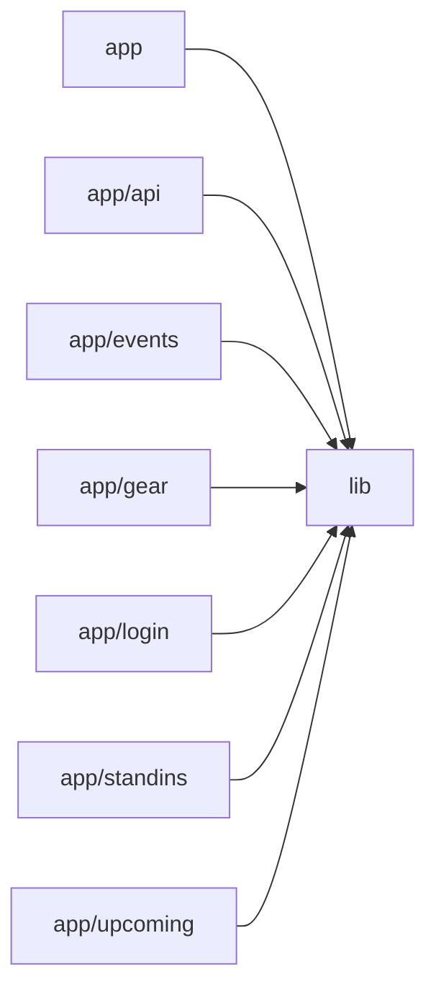

# Architecture

Band Manager is a small Next.js (App Router) + Tailwind PWA that a band uses to share a gig/rehearsal calendar, gear notes and a stand-in list. The `app/` directory holds thin client pages (calendar home, upcoming list, event detail, gear, stand-ins, login) that are all wrapped in a shared `AppShell` and talk to Firestore through service modules in `lib/`. `lib/` also owns Firebase client init, a cookie-mirrored auth context, the event/gear/stand-in services, reusable UI (EventModal, SharedNotes, RichTextEditor, Markdown, CalendarSync) and the iCalendar builder. A single server route, `app/api/calendar/[token]`, uses firebase-admin to serve a token-protected .ics feed so members can subscribe from their phone calendars. Root config whitelists Firebase Storage for next/image and wires Tailwind through PostCSS. Notable gaps: no per-member availability/RSVP model exists yet, auth is a single shared band account, and server-only code (firebase-admin, node fs) lives inside `lib/` alongside client modules.

## Modules

| module | summary | AI |
| --- | --- | --- |
| `(root)` | Next.js and PostCSS build config: Firebase Storage image whitelist, SVG allowance, Tailwind plugin. | — |
| `app` | Root layout (fonts, PWA meta, AuthProvider) and the Monday-first month calendar home page with live events and EventModal. | — |
| `app/api` | GET /api/calendar/[token] route serving the token-protected iCalendar feed via firebase-admin. | — |
| `app/events` | /events/[id] client page showing one event's details with edit/delete through EventModal. | — |
| `app/gear` | /gear page: shared gear notes plus per-member 'what to bring' notes edited in a portal modal. | — |
| `app/login` | /login page for the shared band account; redirects to / when authenticated. | — |
| `app/standins` | /standins page: SharedNotes editor for the free-text stand-in roster. | — |
| `app/upcoming` | /upcoming page listing future events with relative date labels and expandable Markdown details. | — |
| `lib` | Shared library: Firebase client/admin init, auth context + session cookies, Firestore services, ICS builder, and reusable UI components. | — |

## Module dependencies

_`[AI]` marks modules with AI/LLM touchpoints (prompt files, model API calls, agent logic)._
