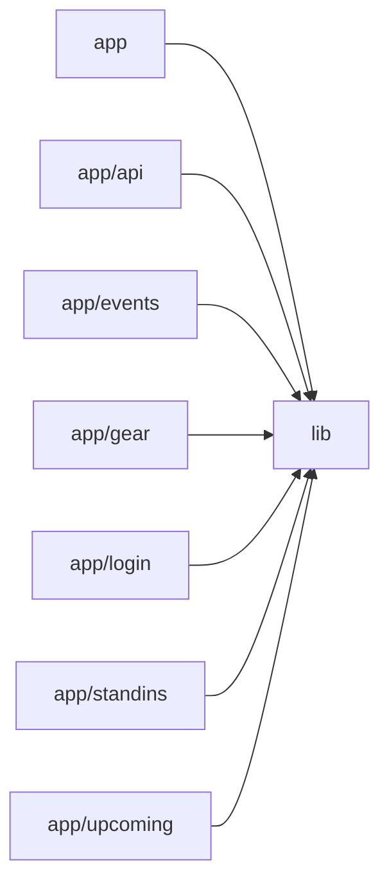

# Architecture

Band Manager is a Next.js (App Router) + Firebase application for a band to coordinate gigs and rehearsals. The `app` directory holds thin client pages (calendar, upcoming list, event detail, gear inventory, stand-ins, login) that are all wrapped in a shared `AppShell` and delegate data access to `lib`. The `lib` module is the core: it initializes the Firebase client and Admin SDKs, exposes Firestore subscription/CRUD services (events, gear, stand-ins, calendar feed tokens), provides the auth context, and ships reusable UI (EventModal, SharedNotes, RichTextEditor, Markdown, CalendarSync). A single server-side API route (`app/api/calendar/[token]`) uses the Admin SDK and the RFC 5545 `ics` helper to serve a token-protected iCalendar feed. Root config files wire up Next.js image domains and Tailwind via PostCSS. No AI/LLM touchpoints exist in the codebase.

## Modules

| module | summary | AI |
| --- | --- | --- |
| `(root)` | Next.js and PostCSS/Tailwind build configuration. | — |
| `app` | Root layout (fonts, metadata, AuthProvider) and the main monthly calendar page. | — |
| `app/api` | Token-authenticated ICS calendar feed route backed by Firebase Admin Firestore. | — |
| `app/events` | Dynamic event detail page with real-time subscription and edit/delete modal. | — |
| `app/gear` | Shared gear inventory notes and per-member 'what to bring' badges. | — |
| `app/login` | Email/password login form using the shared auth context. | — |
| `app/standins` | Shared-notes page for stand-in musicians and crew contacts. | — |
| `app/upcoming` | Chronological accordion list of upcoming events with markdown previews. | — |
| `lib` | Firebase init, auth context, Firestore services, ICS generation, and shared UI components. | — |

## Module dependencies

_`[AI]` marks modules with AI/LLM touchpoints (prompt files, model API calls, agent logic)._
