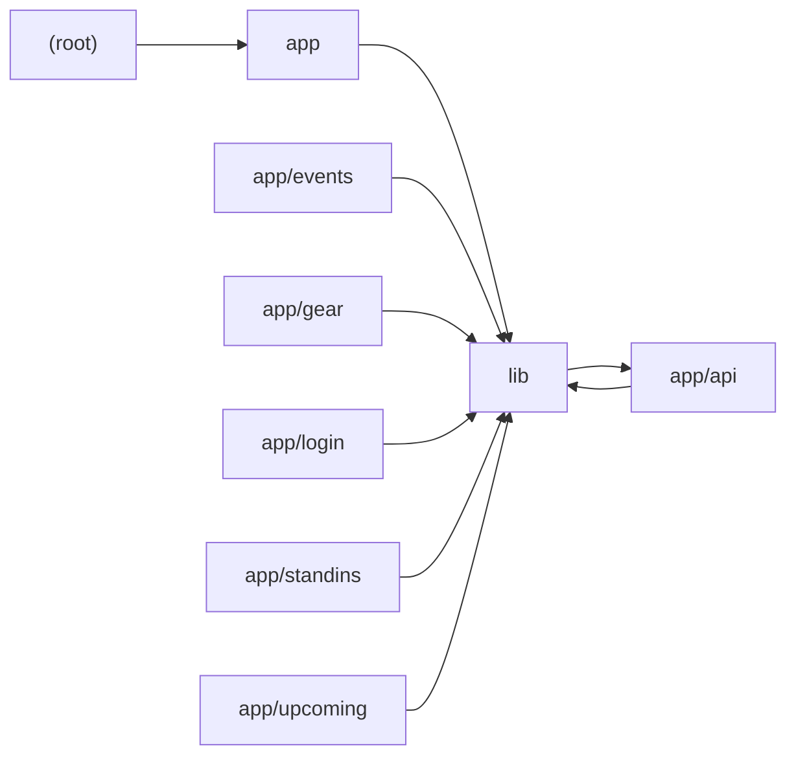

# Architecture

A Next.js (App Router) band-management web app styled with Tailwind CSS and backed by Firebase. Client pages under `app/` (calendar, upcoming list, event detail, gear, stand-ins, login) are thin presentational layers that wrap themselves in the shared `AppShell` and talk to Firestore through subscription/save services in `lib/`. The `lib/` module is the hub of the system: it owns client Firebase init and the React auth context, the server-side Firebase Admin setup and native JWT verification, Firestore services for events/gear/stand-ins/feed tokens, an RFC 5545 iCalendar builder, and reusable UI (EventModal, SharedNotes, RichTextEditor, Markdown, CalendarSync, ChatWidget). Server route handlers in `app/api/` expose a tokenized `.ics` feed and an authenticated streaming AI chat endpoint that assembles live Firestore data into a Danish system prompt and proxies OpenRouter completions; the floating `ChatWidget` in `lib/` consumes that stream via SSE. Root config files wire Tailwind through PostCSS and allow Next.js image optimization for Firebase Storage.

## Modules

| module | summary | AI |
| --- | --- | --- |
| `(root)` | Next.js and PostCSS/Tailwind build configuration, including Firebase Storage image remote patterns. | — |
| `app` | Root layout (fonts, metadata, AuthProvider) and the main monthly calendar page for browsing and managing gigs and rehearsals. | — |
| `app/api` | Server route handlers: tokenized iCalendar feed GET and an authenticated streaming AI chat POST backed by OpenRouter and Firestore context. | [AI] |
| `app/events` | Event detail page that subscribes to a single event in real time and offers an edit modal. | — |
| `app/gear` | Gear page for shared band gear notes and per-member gig equipment needs. | — |
| `app/login` | Email/password sign-in page with post-auth redirect handling. | — |
| `app/standins` | Stand-ins page rendering SharedNotes wired to the stand-in Firestore service. | — |
| `app/upcoming` | Chronological list of upcoming events with collapsible markdown details and links to event pages. | — |
| `lib` | Shared core: Firebase client/admin init, auth context, Firestore services, token verification, iCalendar builder, and reusable UI components including the AI ChatWidget. | — |

## Module dependencies

_`[AI]` marks modules with AI/LLM touchpoints (prompt files, model API calls, agent logic)._
