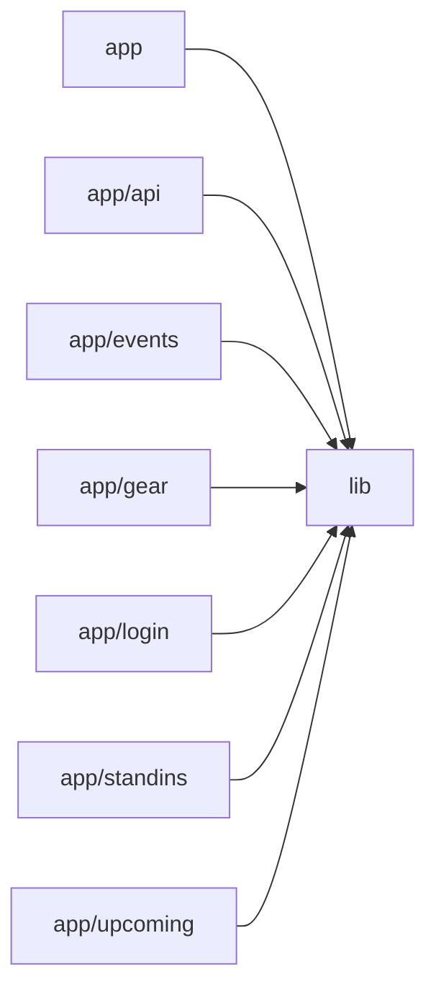

# Architecture

Band Manager is a Next.js (App Router) app backed by Firebase, giving a band one shared place for gigs, rehearsals, gear and stand-ins. The root config sets up Tailwind via PostCSS and allows remote images from Firebase Storage. The app module provides the root layout (AuthProvider, metadata, fonts) and the calendar home page. Route pages (events/[id], upcoming, gear, standins, login) are thin client components that render inside the shared AppShell and consume lib services. The lib module holds everything shared: Firebase client/admin initialization, the auth context and cookie session, Firestore-backed services with real-time subscriptions (events, gear, stand-ins), reusable UI (EventModal, SharedNotes, RichTextEditor, Markdown, CalendarSync), and the iCalendar builder. The unauthenticated app/api/calendar/[token] route validates a rotating feed token, reads events with the Admin SDK and returns an ICS feed so members' phone calendars stay in sync. There are no AI/LLM touchpoints.

## Modules

| module | summary | AI |
| --- | --- | --- |
| `(root)` | Next.js and PostCSS/Tailwind build configuration, including Firebase Storage remote image settings. | — |
| `app` | Root layout with AuthProvider and metadata, plus the home calendar page for viewing and adding events. | — |
| `app/api` | Token-protected route that serves the read-only ICS calendar feed generated from Firestore events. | — |
| `app/events` | Shareable detail page for a single gig or rehearsal, with editing through EventModal. | — |
| `app/gear` | Shared gear inventory and per-musician 'what to bring' notes. | — |
| `app/login` | Email/password sign-in page for the shared band account. | — |
| `app/standins` | Shared editable list of stand-in musicians. | — |
| `app/upcoming` | Chronological, expandable list of upcoming events with relative date labels. | — |
| `lib` | Shared Firebase setup, auth/session, Firestore data services, reusable UI components and ICS feed generation. | — |

## Module dependencies

_`[AI]` marks modules with AI/LLM touchpoints (prompt files, model API calls, agent logic)._
