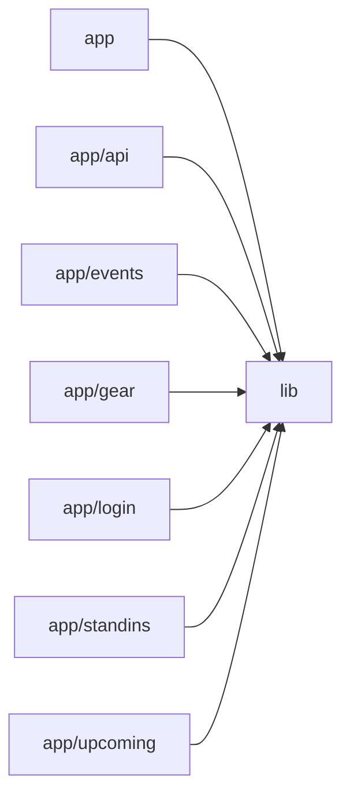

# Architecture

Band Manager is a Next.js (App Router) + Tailwind CSS web app that gives a band one shared tool with four tabs: Calendar (Monday-first month view of gigs and rehearsals), Upcoming (date-ordered list from today onward), Gear (a shared gear list plus per-member 'What to bring' notes) and Stand-ins (a shared free-text list of substitute musicians). Every page is a client component wrapped in AppShell, which enforces the single shared band login (Firebase email+password via AuthProvider/useAuth, mirrored into a js-cookie session) and provides the tab navigation. All data lives in Firestore and is consumed through small service modules in lib/ (eventService, gearService, standinService, calendarFeedService) that expose real-time subscribe* functions returning unsubscribe callbacks plus save/create/update/delete helpers. A standalone event page (/events/[id]) and a shared EventModal provide viewing and editing, with Markdown rendering via react-markdown. A token-protected server route (/api/calendar/[token].ics) uses firebase-admin and lib/ics to build an RFC 5545 iCalendar feed (Europe/Copenhagen, '(TBC)' suffix and TENTATIVE status for pending events) so members' phone calendars stay in sync. Root config files handle Next.js image remote patterns for Firebase Storage and the Tailwind PostCSS plugin. No AI/LLM components are present.

## Modules

| module | summary | AI |
| --- | --- | --- |
| `(root)` | Build/toolchain configuration: Next.js image settings for Firebase Storage and the Tailwind PostCSS plugin. | — |
| `app` | Root layout (fonts, PWA metadata, AuthProvider) and the home Calendar tab with month grid, event dots and EventModal. | — |
| `app/api` | Token-protected GET route that builds the band's read-only .ics calendar feed from Firestore via firebase-admin. | — |
| `app/events` | Standalone live-updating full page for a single gig or rehearsal at /events/[id], with edit via EventModal. | — |
| `app/gear` | Gear tab: shared gear list (SharedNotes) plus per-member 'What to bring' circles and a portal-rendered NeedModal. | — |
| `app/login` | Email/password sign-in screen for the single shared band login with generic error and redirect to '/'. | — |
| `app/standins` | Stand-ins tab: one shared live-editable note of substitute musicians wired to standinService. | — |
| `app/upcoming` | Upcoming tab: chronological list of future events with relative labels, expandable Markdown details and full-page links. | — |
| `lib` | Shared library: AppShell, auth/session, Firebase client/admin init, Firestore services, ICS builder, EventModal, Markdown, SharedNotes and RichTextEditor. | — |

## Module dependencies

_`[AI]` marks modules with AI/LLM touchpoints (prompt files, model API calls, agent logic)._
