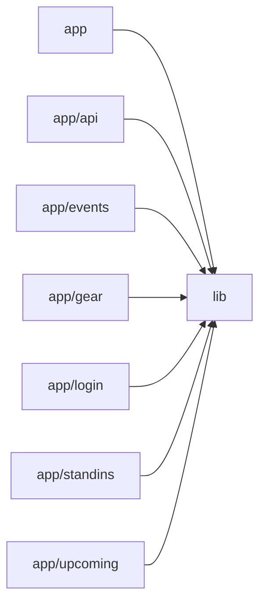

# Architecture

Band Manager is a Next.js (App Router) + Firebase PWA for a single shared band account. The `app` directory holds thin client pages (calendar, upcoming list, event detail, gear, stand-ins, login) that are all wrapped by `AppShell` for navigation and route protection, plus one server-side API route that serves an authenticated iCalendar feed. Nearly all logic lives in `lib`: client Firebase/Auth initialization, Firestore service modules exposing `subscribeTo*`/`save*`/CRUD functions, an RFC 5545 ICS generator, calendar feed token management, and shared UI components (EventModal, SharedNotes, RichTextEditor, Markdown, CalendarSync). Root config files wire Tailwind via PostCSS and Next.js image settings. There are no AI/LLM touchpoints in the codebase.

## Modules

| module | summary | AI |
| --- | --- | --- |
| `(root)` | Next.js image config and PostCSS/Tailwind build configuration. | — |
| `app` | Root layout (fonts, metadata, AuthProvider) and the main monthly calendar page. | — |
| `app/api` | Token-authenticated ICS calendar feed route reading events from Firestore via the Admin SDK. | — |
| `app/events` | Event detail page with real-time subscription and edit/delete modal. | — |
| `app/gear` | Shared gear inventory notes and per-member 'what to bring' badges. | — |
| `app/login` | Email/password login form using useAuth with redirect handling. | — |
| `app/standins` | Stand-in musicians/crew contacts page backed by SharedNotes. | — |
| `app/upcoming` | Chronological accordion list of upcoming events with markdown previews. | — |
| `lib` | Core library: Firebase client/admin init, auth context, Firestore services, ICS generation, and shared UI components. | — |

## Module dependencies

_`[AI]` marks modules with AI/LLM touchpoints (prompt files, model API calls, agent logic)._
