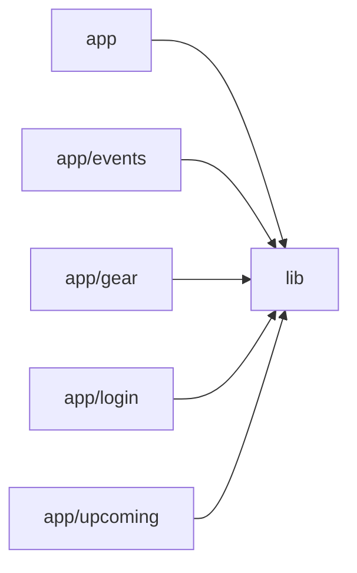

# Architecture

A Next.js (App Router) band management PWA styled with Tailwind CSS and backed by Firebase (Firestore + Auth). The `lib` module is the shared core: it provides an authentication context (`AuthProvider`/`useAuth`), the responsive `AppShell` layout with top and bottom navigation, Firestore-based event and gear services with real-time subscriptions, cookie-based session persistence, and reusable UI primitives (`Markdown`, `RichTextEditor`, `EventModal`, `TYPE_COLOR`). Feature pages under `app/` compose these primitives: the root calendar page (`app/page.tsx`), event detail (`app/events/[id]`), upcoming events list (`app/upcoming`), gear inventory (`app/gear`), and login (`app/login`). The root config module wires up Next image optimization for Firebase Storage and Tailwind via PostCSS. All feature pages are client components that subscribe to Firestore data through the `lib` services and render markdown content through shared components.

## Modules

| module | summary | AI |
| --- | --- | --- |
| `(root)` | Next.js and Tailwind/PostCSS configuration including Firebase Storage image remote patterns. | — |
| `app` | Root layout with auth provider/fonts/PWA setup and the monthly calendar page. | — |
| `app/events` | Individual event detail page with markdown descriptions and edit modal. | — |
| `app/gear` | Band gear inventory and per-member 'what to bring' checklist with modal editors. | — |
| `app/login` | Client-side email/password login page using the auth hook. | — |
| `app/upcoming` | Chronological list of upcoming events with expandable previews. | — |
| `lib` | Core shared library: auth context, Firebase services, app shell, and UI primitives. | — |

## Module dependencies

_`[AI]` marks modules with AI/LLM touchpoints (prompt files, model API calls, agent logic)._
